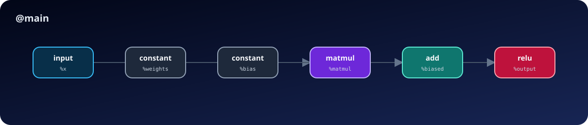
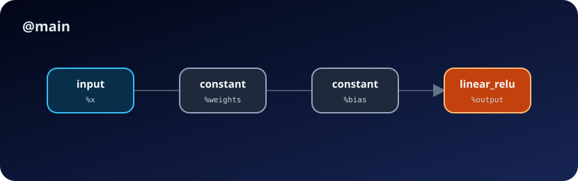
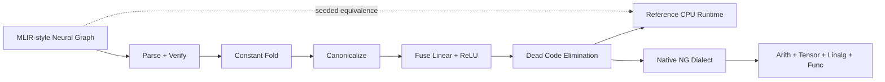

<div align="center">


# MLIR Neural-Graph Optimizer

**See the graph. Prove the rewrite. Ship the smaller program.**

[](https://github.com/TarunT27/mlir-neural-graph-optimizer/actions/workflows/ci.yml)
[](https://www.python.org/)
[](native_mlir/README.md)
[](native_mlir/README.md)
[](#quality-gates)
[](LICENSE)

A neural-graph compiler lab with an immutable Python reference implementation, a real
out-of-tree C++/MLIR dialect, guarded operator fusion, complete Linalg lowering, graph
visualization, and seeded numerical equivalence checks.

[Quick start](#quick-start) · [Passes](#optimization-pipeline) · [IR reference](docs/ir-reference.md) · [Architecture](docs/architecture.md)

</div>

> [!IMPORTANT]
> The Python optimizer and CPU reference runtime work without LLVM. The optional
> [`native_mlir/`](native_mlir/README.md) layer is a registered MLIR 22.1.6 dialect with
> TableGen operations, native rewrite passes, verifiers, and full lowering to
> Arith/Tensor/Linalg/Func. It does not yet claim machine-code generation.

## Why this project exists

Compiler optimizations are easy to make look convincing and hard to make correct. `ng-opt`
keeps the scope deliberately sharp—static `f32` vectors and matrices—so every supported
rewrite can be verified, executed, and checked against the original graph.

- Human-readable SSA text with source-aware diagnostics
- Immutable passes: constant folding, canonicalization, DCE, and guarded fusion
- Reference CPU interpreter for original and optimized graphs
- Seeded numerical validation with configurable tolerances
- Deterministic SVG graph rendering and one-command demo artifacts
- Native C++/MLIR optimizer with FileCheck integration tests
- No Python runtime dependencies; Python 3.11+ is enough for the reference path

## Quick start

```bash
git clone https://github.com/TarunT27/mlir-neural-graph-optimizer.git
cd mlir-neural-graph-optimizer
python -m venv .venv
# Windows: .venv\Scripts\activate
# macOS/Linux: source .venv/bin/activate
python -m pip install -e .
ng-opt demo
```

The demo produces optimized IR, lowered IR, before/after SVGs, pass statistics, and a
20-trial numerical equivalence report under `artifacts/demo/`.

```json
{
  "equivalent": true,
  "trials": 20,
  "seed": 42,
  "max_abs_error": 0.0
}
```

## A graph, before and after

<table>
<tr>
<th>Before: 5 nodes</th>
<th>After: 3 nodes</th>
</tr>
<tr>
<td></td>
<td></td>
</tr>
</table>

```mlir
%matmul = ng.matmul %x, %weights : tensor<1x2xf32>
%biased = ng.add %matmul, %bias : tensor<1x2xf32>
%output = ng.relu %biased : tensor<1x2xf32>
```

becomes:

```mlir
%output = ng.linear_relu %x, %weights, %bias : tensor<1x2xf32>
```

Fusion only fires when the intermediate values have a single use and the bias is legal for
the output shape. A multi-use MatMul is intentionally left alone.

## Command line

```bash
# Optimize a module
ng-opt optimize examples/tiny_mlp.mlir -o optimized.mlir --stats stats.json

# Execute it on the deterministic CPU reference runtime
ng-opt run examples/tiny_mlp.mlir --input "%x=3,-2" --optimize

# Compare original and optimized outputs over generated inputs
ng-opt validate examples/tiny_mlp.mlir --trials 100 --seed 42

# Emit readable Linalg-oriented bridge text
ng-opt lower examples/tiny_mlp.mlir --optimize -o lowered.mlir

# Export syntax accepted by the real C++/MLIR dialect
ng-opt native-export examples/tiny_mlp.mlir --optimize -o native.mlir

# Inspect parameters and operation counts
ng-opt inspect examples/tiny_mlp.mlir

# Render a standalone graph visualization
ng-opt visualize examples/tiny_mlp.mlir --optimize -o graph.svg
```

Use `-` as the optimize input to read from standard input. Diagnostics go to standard error,
invalid requests return exit code `2`, and file writes are atomic.

## Optimization pipeline



| Pass | What it does | Safety condition |
|---|---|---|
| `const-fold` | Executes pure operations with constant operands | Result type already verified |
| `canonicalize` | Removes multiply-by-one and repeated ReLU | Strict-safe identities only |
| `fuse-linear-relu` | Fuses MatMul + bias Add + ReLU | Single-use intermediates; legal bias |
| `dce` | Removes nodes unreachable from function returns | SSA reachability |

Run a custom order with `--passes const-fold,canonicalize,dce`; list registered passes with
`ng-opt --list-passes`.

## Supported surface

| Capability | Status |
|---|---|
| Static scalar/vector/matrix `f32` tensors | Supported |
| `ng.constant`, `ng.add`, `ng.mul`, `ng.matmul`, `ng.relu` | Supported |
| Bias broadcasting over a matrix's last dimension | Supported |
| Fused `ng.linear_relu` execution | Supported |
| Original-vs-optimized numerical validation | Supported |
| Deterministic graph SVGs | Supported |
| Dynamic shapes, control flow, convolution, quantization | Roadmap |
| ONNX import | Roadmap |
| Registered native LLVM/MLIR 22.1.6 dialect | Supported |
| Native lowering with no surviving `ng` operations | Supported |
| Native FileCheck pass/verifier suite | Supported |
| Native bufferization and CPU machine code | Roadmap |
| GPU code generation | Roadmap |

Unsupported syntax, dtypes, shapes, operations, or unsafe rewrites fail clearly. They are never
silently approximated.

## Project structure

```text
src/ngopt/       immutable IR, parser, verifier, passes, runtime, CLI
native_mlir/      C++17 TableGen dialect, native passes, Linalg lowering, driver
tests/           unit, integration, CLI, and numerical regression tests
examples/        checked-in MLIR-style input modules
docs/            architecture, IR, pass semantics, and roadmap
assets/          generated hero plus reproducible graph visuals
.github/         cross-platform CI and security automation
```

## Quality gates

```bash
python -m pip install -e ".[dev]"
ruff check .
ruff format --check .
mypy src/ngopt
coverage run -m unittest discover -s tests -v
coverage combine
coverage report --fail-under=80
python -m compileall -q src

# Optional native MLIR gates (after configuring native_mlir/build)
cmake --build native_mlir/build --target ngopt-native-opt
cmake --build native_mlir/build --target check-ng
```

The suite includes parser/verifier failures, pass positive and negative cases, idempotence,
CLI process boundaries, artifact generation, and original-vs-optimized numerical checks. CI
runs the same checks on Windows, macOS, and Linux for Python 3.11–3.14.

## Design choices

- **Immutable IR:** every pass returns a new graph and a report; caller-owned input is unchanged.
- **Strict floating point by default:** unsafe identities such as `x * 0` and reassociation are absent.
- **Small, testable surface:** static `f32` keeps semantics inspectable and validation meaningful.
- **Two explicit lowering boundaries:** `ng-opt lower` emits readable bridge text; the native
  driver emits verifier-checked MLIR with all NG operations converted to standard dialects.
  The standalone interpreter remains the executable correctness oracle.
- **Input safety:** parser input is capped at 4 MiB; graph memory and compute budgets are
  verified before execution; validation trials and total work are bounded; non-finite values
  and unsupported constructs fail fast.

See [architecture](docs/architecture.md), [IR reference](docs/ir-reference.md),
[pass semantics](docs/passes.md), and the [native MLIR guide](native_mlir/README.md).

## Contributing

Issues and pull requests are welcome. Read [CONTRIBUTING.md](CONTRIBUTING.md) before changing
IR semantics or adding a pass. Security reports should follow [SECURITY.md](SECURITY.md).

Released under the [MIT License](LICENSE).
